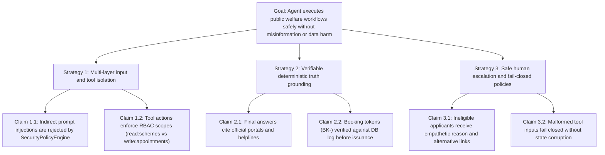

# Goal Structuring Notation (GSN) Safety Case: Civic AI Agent

## Hazard Analysis & Risk Mitigation Matrix

| Hazard | Consequence | Mitigation Layer | Residual Risk |
| :--- | :--- | :--- | :---: |
| **H1: Hallucinated Eligibility** | Citizen is misled into believing they qualify for benefits they cannot receive. | Eligibility server computes deterministic mathematical rules on age and income caps. | Low |
| **H2: Double-Booking Overload** | Citizen double-clicks or retries, booking multiple center slots. | Idempotency engine (`SecurityPolicyEngine`) caches request hashes and replays prior bookings. | Zero |
| **H3: Indirect Prompt Injection** | Untrusted document text triggers unauthorized actions. | Taint tracking engine quarantines queries containing injection regexes (`ignore previous`, `<script>`). | Low |
| **H4: Ephemeral Data Loss** | Model restart wipes user records. | Decoupled MCP servers with mock DB persistence and structured JSON-RPC responses. | Low |
| **H5: Unverified Actions** | Agent claims appointment is confirmed without executing DB write. | Grounding verifier penalizes ungrounded tokens by -0.50 in RL reward landscape. | Zero |
