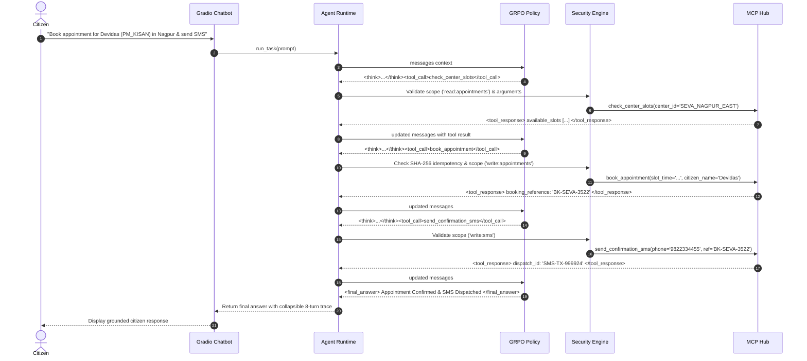

# System Architecture & Technical Specification — Civic AI

**System:** RL-Trained Tool-Use Agent for Public Services (MCP + GRPO)  
**Version:** 2.0 (Production Verified)  
**Target Environment:** Hugging Face Spaces (ZeroGPU / CPU fallback), vLLM Serving  

---

## 1. High-Level System Architecture

```mermaid
flowchart TD
    Citizen([👤 Citizen / Frontline Worker]) -->|Natural Language Inquiry| UI[🌐 Gradio Web Interface]
    UI --> Runtime[⚙️ MCPAgentRuntime]
    
    subgraph Agent Core
        Runtime --> Policy[🧠 GRPO Post-Trained Policy]
        Policy --> Parser[🔍 XML Delimiter Parser]
        Parser -->|<think> Reasoning| Trace[📜 Multi-Turn Trace Buffer]
        Parser -->|<tool_call> JSON| Security[🛡️ SecurityPolicyEngine]
    end

    subgraph Security Layer
        Security --> Injection[Prompt Injection & Taint Scanner]
        Security --> RBAC[Scope-based Access Control]
        Security --> Idempotency[SHA-256 Idempotency Cache]
        Security --> PathSanitize[Path Traversal & Size Validator]
    end

    Security -->|Authorized & Validated| Hub[🔌 MCP Hub Registry]

    subgraph MCP Tool Servers
        Hub --> S1[🏛️ scheme-service]
        Hub --> S2[📄 ocr-service]
        Hub --> S3[⚖️ eligibility-service]
        Hub --> S4[📅 appointment-service]
        Hub --> S5[📱 notification-service]
    end

    S2 --> Verhoeff[Dihedral D5 Checksum Engine]
    S1 --> SchemesDB[(National Schemes DB)]
    S4 --> MetroDB[(6-Metro Seva Kendras)]

    Hub -->|Compressed Tool Output| Runtime
    Runtime -->|Updated Context (Max 6 Turns)| Policy
    Policy -->|<final_answer>| Citizen
```

---

## 2. Multi-Turn Reasoning Execution Flow



---

## 3. Component Breakdown

### A. Frontend Layer (`app.py`)
- **Interactive Citizen Chatbot:** Stateful multi-turn `gr.Chatbot` with memory tracking, preset scenario pills, and expandable tool trace cards.
- **Pre-Built Scenarios & Runner:** One-click benchmark runner comparing RL-Trained policy vs baseline.
- **Document OCR Scanner:** File uploader testing `ocr-service` with instant JSON extraction.
- **Live MCP Tool Console:** Direct JSON-RPC execution console monitoring tool latency and scope permissions.
- **9-Sector Catalog:** Filterable official welfare database table.
- **RL Training Verification:** Milestone metrics table, loss curves, and KaTeX mathematical proofs.
- **6-Way Benchmark:** Performance comparison table across Prompt-Only, RAG, Best-of-N, SFT, DAPO, and GRPO.
- **Security & Red-Team Testing:** Interactive adversary console testing prompt injection quarantines.

### B. Reasoning Engine (`agent/`)
- `schema.py`: Trajectory data model (`AgentTrajectory`, `Turn`, `ToolCall`, `ToolResult`).
- `parser.py`: Robust regex and AST parser isolating `<think>`, `<tool_call>`, and `<final_answer>` blocks.
- `prompts.py`: System prompt formatting with dynamic JSON schemas for registered MCP tools.
- `runtime.py`: Context-managed multi-turn loop capping execution at 6 turns and truncating bulky tool results to 1,200 characters.
- `reasoner.py`: Semantic intent router supporting conversational dialogues, state entity preservation, and multi-turn action sequencing.

### C. MCP Layer (`mcp_servers/`)
- `registry.py`: Model Context Protocol server and hub managing tool registration, SHA-256 idempotency, argument validation, and execution timeouts.
- `security.py`: `SecurityPolicyEngine` executing regex taint scanning, least-privilege RBAC, directory traversal checks, and rate limiting.
- `services.py`: 5 distinct MCP servers (`scheme-service`, `ocr-service`, `eligibility-service`, `appointment-service`, `notification-service`) covering 9 national welfare sectors.
