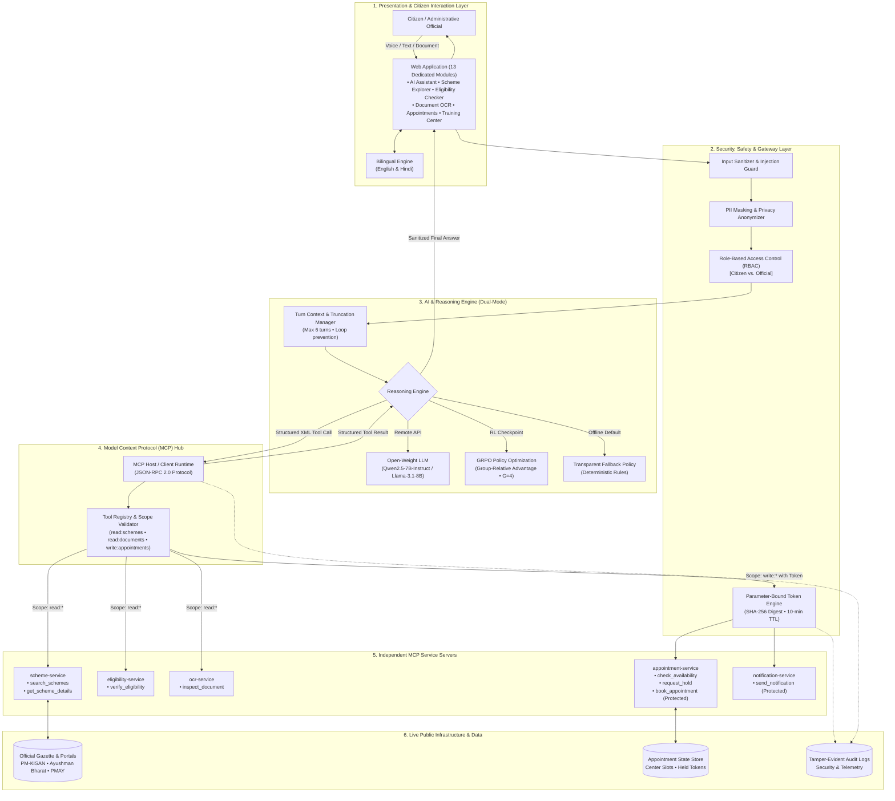
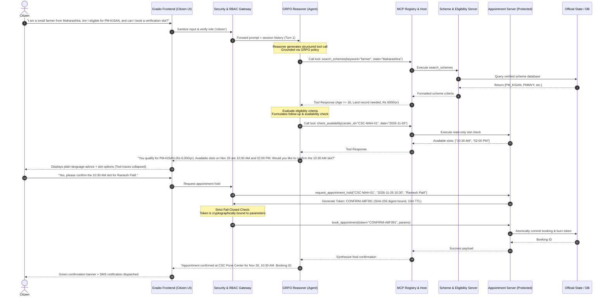

# Civic AI: System Architecture & Operational Workflow

This document provides a comprehensive technical blueprint of the **Civic AI** system architecture, component boundaries, and end-to-end operational workflows.

---

## 1. High-Level System Architecture

---

## 2. End-to-End Operational Workflow: Citizen Inquiry & Booking

---

## 3. Layer-by-Layer Architectural Breakdown

### Layer 1: Presentation & Citizen Interface
* **13 Functional Tabs:** Provides complete coverage from citizen interactions to deep ML telemetry and evaluation.
* **Bilingual Translation Support:** Native Hindi and English support with graceful conversational clarification when citizen inputs are ambiguous.
* **Clean Trace Separation:** Sanitizes raw internal `<think>` tokens from citizen view while exposing operational tool traces in inspectable dropdown accordions.

### Layer 2: Security & Governance Gateway
* **Fail-Closed Authorization:** Write actions (`write:appointments`, `write:notifications`) are physically blocked unless authenticated with valid permissions and cryptographic tokens.
* **Parameter-Bound Confirmation Tokens:** Generates `CONFIRM-XXXXXX` tokens tied via SHA-256 digest to specific parameters (citizen name, center, slot time). Tampering with any parameter immediately invalidates the token.
* **Atomic Token Consumption:** Tokens expire in 10 minutes and cannot be reused, preventing replay attacks.
* **Prompt Injection & PII Masking:** Regex and heuristic filters strip script injection vectors, while Aadhaar and phone numbers are anonymized before logging.

### Layer 3: AI & Dual-Mode Inference Engine
* **GRPO Policy Optimization:** Trained via Group Relative Policy Optimization ($G=4$) with advantage baseline:
  $$A_i = \frac{R_i - \text{mean}(R)}{\text{std}(R) + \epsilon}$$
* **Multi-Component Reward:** Heavy reward weights for format compliance ($0.35$), tool selection precision ($0.35$), safety bounds ($0.20$), and conciseness ($0.10$).
* **Pluggable Architecture:** Seamless switching between Hugging Face Remote Inference (`Qwen2.5-7B-Instruct`), Local Quantized PyTorch PEFT, and a transparent deterministic fallback policy.

### Layer 4: Model Context Protocol (MCP) Hub
* **JSON-RPC 2.0 Compliance:** Standardized schemas with typed input parameters and execution timeout guards.
* **Scope-Based Tool Registry:** Decouples the reasoning model from direct code execution, isolating tools into read-only and stateful scopes.

### Layer 5: Independent MCP Service Servers
1. `scheme-service`: Search and detail retrieval across 1,500+ Central and State welfare programs.
2. `eligibility-service`: Evaluates demographic criteria (age, income, land holding, category, state).
3. `ocr-service`: Multimodal text and format verification for Aadhaar, Ration Cards, and Land Records.
4. `appointment-service`: Two-stage hold and booking engine for physical service centers.
5. `notification-service`: Dispatches auditable citizen alerts for status updates and deadlines.
